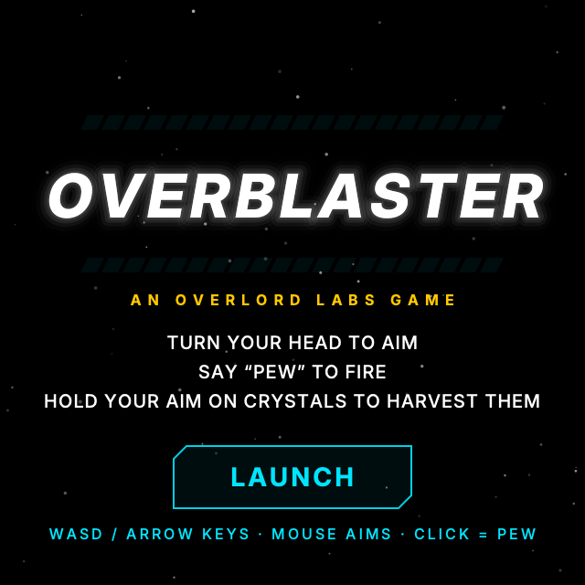
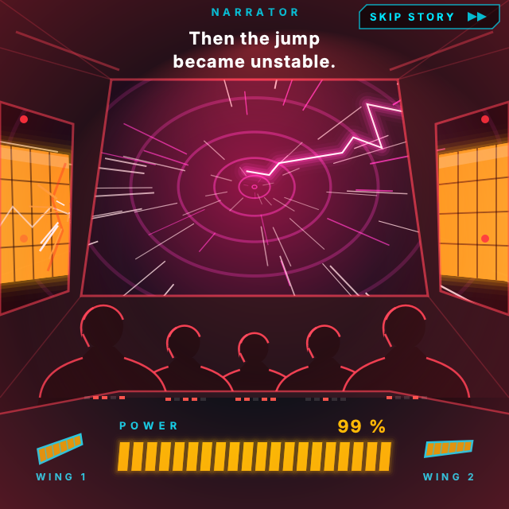
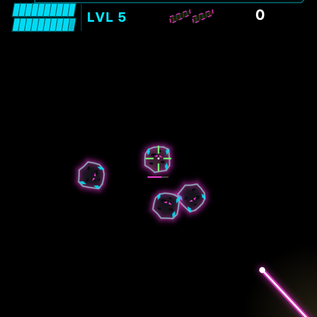
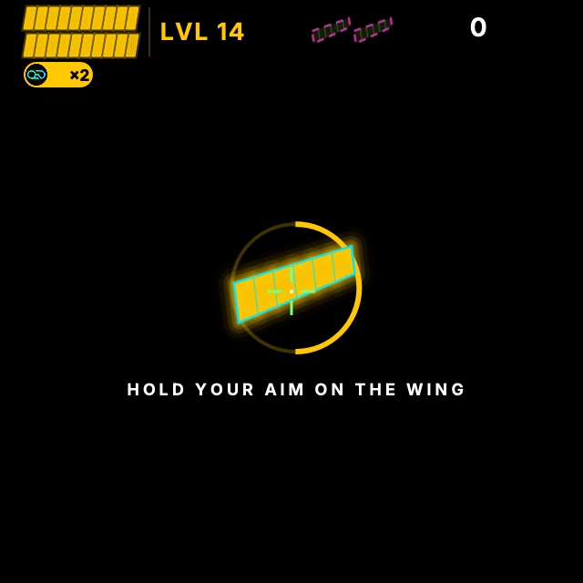
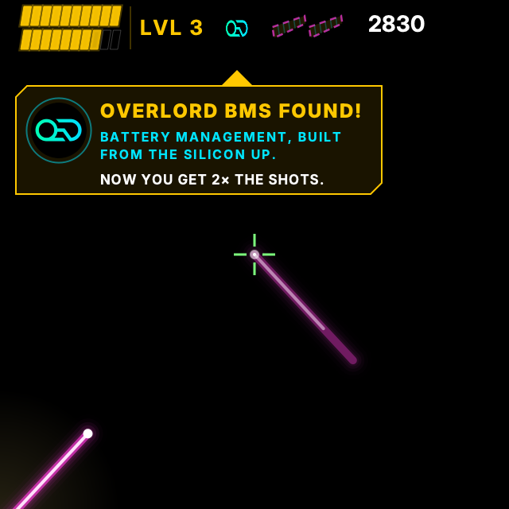

# OverBlaster

**An OverLord Labs game for the Raven Prism smart glasses.**

You are in a spaceship. Blast the **Rubble** before it reaches you, then harvest the **energy crystals** it drops.
Crystals recharge your battery, and every "Pew" spends some. Run out of battery, or let a rock reach your ship, and
you lose. From level 3, a gold rock drops the **Overlord BMS**, a battery management chip that doubles your battery
capacity. Later, some rocks spit out **bad gauges** that cut it back down. The whole story opens on the stranded
mothership *Meridian*, which has lost both battery wings: find them at levels 14 and 28 and bring them home.

**The design is the web game's.** [OverBlaster-web](https://github.com/OverLord-Labs/OverBlaster-web) is the source of truth
for the rules, the levels, the story and how everything looks. This app is its port to the glasses: `overblaster/core/`
is a Python port of the web `src/core` (tested against it with a golden file, see Testing) and `overblaster/render/` is a
QPainter port of the web renderer. When the web design changes, change it there first and port it here.

| | |
|---|---|
|  |  |
|  |  |
|  | |

(Rendered offscreen by `tools/render_scene.py` from the real code.)

| You do | The game reads |
|---|---|
| Turn your head | IMU: the sky scrolls around you |
| Look at something | Eye gaze: moves the crosshair, only when it is steady (high confidence). Otherwise the crosshair stays centered |
| Say "Pew" (or anything loud) | Microphone level above a threshold pulls the trigger. It stays pulled while the sound goes on, firing 10 shots a second: "pew" is a short burst, "pewwwww" is continuous fire |
| Hold the crosshair on a crystal for 0.3 s | Harvests it (the BMS and the battery wings take 2.4 s) |
| Rest your gaze on a plate for 1.5 s | Presses LAUNCH, RETRY, TITLE or SKIP STORY (the glasses have no click) |

No 3D: the screen is one painted 2D picture on a black background. Black is transparent on the additive display, so
most of the screen is unlit.

## Layout

```
main.py                 entry point (simulator / deploy)
overblaster/
  core/                 THE GAME: rules, 42 levels, the story timeline, a bot. Pure Python, a port of the web src/core
    game.py levels.py intro.py view.py constants.py ...  (one module per web file; see core/__init__.py)
  render/               QPainter port of the web renderer: draw.py (canvas-like Draw/Ctx), screens.py, story.py,
                        playfield.py, hud.py, pickups.py, arrows.py, sprites.py, scene.py (dispatch on the phase)
  scenelayer.py         the one full-screen widget that paints the scene (and the debug panel)
  dwell.py              gaze-dwell plates: LAUNCH, RETRY, TITLE, SKIP STORY (no widgets; the scene draws them)
  app.py                RavenApp: sensors -> core.Game input -> scene, sound events -> Sound, the tick loop
  config.py             sensor, microphone, audio, tick and dwell tunables (the game's own numbers are core/constants.py)
  sensors.py            HeadTracker, GazeAim, VoiceTrigger filters       (pure Python)
  inputs.py             reads the IMU / eye tracker / microphone
  macimu.py mousetap.py this Mac's IMU; the simulator's mouse (moves and clicks)
  debug_scenes.py       jump a game to a known moment (the web demo's #test= scenes)
  synth.py audio.py sound.py audiosink.py dsp.py   sound: see "Sound"
assets/                 overlord_od.png and the audio clips
tools/                  render_scene.py, compare_web.py (pixel diff against the web game), bench_tick.py, audio tools
tests/                  pytest suite (see Testing)
docs/screenshots/       the pictures above
raven-framework/        the framework, cloned here for development (git-ignored)
```

## The game

Everything below is defined in `overblaster/core/` (and shown in the web game); nothing here is specific to the glasses.

- **Levels:** 42, each with a name (THE FAR SIDE ... THE OVERLORD CORE). Levels 1 to 3 are hand-set; from 4 on `levels.py` plans the
  rocks (streams, clusters, swarms, pincers, bosses) from a difficulty curve (`LOADS`). Rocks take 3 to 6 hits.
- **Battery:** 100 units, one per shot, 3 per crystal. Out of battery with rocks left, or a rock reaching you, ends the run.
- **The Overlord BMS (level 3):** a huge tough cluster bleeds your battery down; the gold rock inside drops the chip. Hold your
  aim on it for 2.4 s (a slip drains the hold slowly and never resets it) and capacity doubles to 200.
- **Bad gauges (from level 7):** some rocks eject a red (-70%) or blue (-80%) gauge that homes in on your aim. Keep your aim off it:
  if it stays in your aim for 2 s (4 s the first time) it takes the doubling away until a rock ejects a new BMS.
- **Battery wings (levels 14 and 28):** one of the *Meridian*'s wings drifts in. Hold your aim on it for 2.4 s. The level will not end until
  you have it. The HUD shows the two wings beside the level number; both home wins the game.
- **The story intro:** 7 narrated lines on the stranded bridge (the POWER meter falls 100, 50, 0 as each wing tears away), the route
  hologram, then 3, 2, 1, GO into level 1. SKIP STORY (a dwell plate, or Escape) jumps to the countdown.
- **Screens:** title, level-start splash (hung in the sky above where you were looking), SECTOR CLEARED plate (acknowledged by a fresh
  "Pew" or Space after 2.5 s), BMS-found card, game over and win.

## The app

`app.py` is the only place the glasses meet the game. Each tick it reads the sensors, builds a `core.InputFrame`, calls
`Game.update(dt, input)`, plays the sound events the core drains, and asks the scene layer to repaint:

| Sensor | InputFrame |
|---|---|
| head (IMU, Mac IMU, or the arrow keys) | `head` (absolute azimuth and elevation: the view) |
| gaze, when steady (simulator: the mouse) | `pointer` with `mouse=True` (the crosshair); otherwise it sits in the centre |
| voice level over `VOICE_HI`, echo-gated | `fire` (held while the sound goes on); space also fires |
| gaze resting on a plate (or a mouse click) | `presses` at the plate's box (`core/layout.py`) |
| Enter, Escape, C or R | `launch`, `skipStory`, recenter |

The microphone is only opened while playing. The core knows nothing about any of this, so the same `Game` runs in the web game, in the
tests, and here. The core ticks at `TICK_HZ` (20 by default, see `config.py`; set `OVERBLASTER_TICK_HZ` to change it).

## Setup

```sh
python3 -m venv .venv
.venv/bin/pip install pytest pillow
git clone https://github.com/RavenResonance/raven-framework.git
.venv/bin/pip install -e ./raven-framework
.venv/bin/python -m pytest
```

The framework is proprietary (Raven Resonance, Inc.). It is cloned inside this folder only so the
game can import it, and `.gitignore` keeps it out of this repo.

Run in the simulator:

```sh
.venv/bin/python main.py
```

Off a Raven device the game detects the simulator automatically and fills in for the missing
hardware. There is deliberately **no fire button**: you fire by making noise.

| Glasses | In the simulator |
|---|---|
| IMU (head) | **This Mac's own accelerometer and gyroscope** (Apple Silicon laptops). Raise the far edge of the lid to look up, turn the laptop to look around. If no Mac sensor is found, the arrow keys steer instead. |
| Eye gaze | The mouse. The crosshair goes exactly where the mouse is, inside the game area. |
| Microphone | The Mac's microphone. Say "Pew", clap, anything louder than the threshold. Keep making noise to keep firing. |

The screen is clean: there is no debug text. When you need to tune something, run with
`OVERBLASTER_DEBUG=1` to bring back a **debug panel** at the bottom-left. It shows the live
microphone level against the fire threshold (white mark: re-arms below it, gold mark: fires above
it), which IMU is in use with the head's yaw and pitch, and what the crosshair is following.

While testing the Mac IMU, click the window and press **C** to recenter the view, and **Y** or
**P** to flip the yaw or pitch direction if the view moves the wrong way. The terminal prints
which sign won (the panel shows it too), so you can copy it into `MAC_YAW_SIGN` / `MAC_PITCH_SIGN` in `config.py`.

If "Pew" does nothing, run with `OVERBLASTER_DEBUG=1` and watch the panel. The bar should jump when you speak. If it never gets near
the gold mark, lower `VOICE_HI` (or set `OVERBLASTER_VOICE_HI`, for example `0.03`). A quiet room
reads about 0.005, so the default of 0.05 is about ten times that and a normal speaking voice
fires it. If it fires on background noise, raise it. Check `System Settings >
Privacy & Security > Microphone` allows your terminal.

`python -m overblaster.macimu` prints what the Mac's motion sensors report. `OVERBLASTER_SIM=1`
forces simulator mode.

Deploy to the glasses:

```sh
RAVEN_APP_ID=... RAVEN_APP_KEY=... .venv/bin/python main.py deploy
```

Keep the id and key out of the repo.

## Testing

`.venv/bin/python -m pytest` runs about 290 tests in under a minute:

- **The core** (`test_core_game`, `test_core_parity`): the web game's rules in executable form (battery maths, chip doubling, wings gate
  the level, the intro cues, determinism), plus **parity with the web game**: `tests/golden/core_parity.json` is dumped from the web core
  (`npx tsx scripts/golden.ts` in OverBlaster-web) and holds the random sequence, level plans, scripted runs, the intro event stream and bot
  results. The Python core must reproduce it, so a rule changed on one side and not the other fails here.
- **The renderer** (`test_render_draw`, `test_render_story`, `test_render_playfield`): offscreen QPainter renders of the title, the whole
  intro, 28 playfield scenes and bot-driven sweeps. `tools/compare_web.py <scene>...` renders a scene in the web game (headless Chrome) and
  here, and writes a side-by-side with a pixel diff (about 0.1% to 3% of pixels: anti-aliasing and glow).
- **Sensors and sound** (`test_sensors`, `test_inputs`, `test_macimu`, `test_audio`, `test_dsp`, `test_sound`, `test_sound_events`, `test_synth`).
- **App flow on fake widgets** (`test_app_smoke`, `test_dwell`, `fake_raven.py`): title to launch to intro to skip to play (a loud sound fires, a
  held gaze harvests, the BMS, a wing, the plate, game over, retry, title) through the app's real `_tick` with fake sensors.
- **Real framework, offscreen** (`test_real_framework`, `real_framework_*.py`): a scripted player clears levels 1 to 4 on the real
  `raven_framework` widgets (the BMS doubles capacity, the widget count never changes, the scene really paints); the simulator experience
  (a real mouse event moving the crosshair, the real microphone, this Mac's accelerometer, the HUD, splash and arrows really painted); the
  simulator's picture lining up with its mouse mapping. They run in separate processes and are skipped if the framework isn't installed.

`tools/bench_tick.py` times a tick and a paint over levels 1, 7 and 14 and the intro (on a MacBook Air: 2 to 5 ms a gameplay frame, up to
about 20 ms in the busiest intro frame; the glasses' board is slower and has not been measured).

## What the framework source taught us

The Raven docs are thin, so these come from reading `raven_framework` 1.0.6 itself. They shaped
the code, and several differ from the docs:

- `MediaViewer` is fixed-size, reloads its image on every resize, paints an opaque black box behind every image (cutting holes in
  anything it overlaps) and keeps animating a hidden GIF. The first version of this app was built around those limits (pre-rendered
  size bands, solid-bar crosshair, paused sprites). The app no longer uses it: the whole scene is one `QPainter` widget
  (`scenelayer.py`), which also avoids a per-sprite widget pool. For the same reason the framework `Button` is not used: it paints an
  opaque black box (and an outline) whatever `background_color` says, which would hide the scene's own LAUNCH plate, so the gaze dwell
  is done in `dwell.py` instead and the scene paints the fill.
- `fade_in()` leaves a graphics effect on the game container for good, and the simulator draws its
  picture with `QWidget.render()`, which shifts a child that has an effect by that child's own
  offset. Everything in the game then appeared (40, 50) px away from where the simulator sends
  the mouse, so the crosshair sat off the cursor. The game removes the effect once the fade is done.
  This probably affects any app that calls `fade_in(self.app)` and uses the simulator.
- `Microphone` has **no** `get_level()`. Off-device the level arrives through its `levelChanged`
  signal every 20 ms. On the glasses it is `mic.sensorlib_client.get_microphone_level()`. The game
  ticks every 50 ms, so it holds the peak between ticks (a short "Pew" can't slip between two
  looks). Off-device the framework also keeps all audio in memory (about 5 MB per minute), so
  `inputs.py` restarts the recording every 30 s.
- IMU values are `{"x", "y", "z"}` dicts, and the simulator puts gravity on z with the gyroscope
  always zero.
- The simulator's `EyeControl` returns the mouse position in the 720 px window's coordinates, which
  neither matches the 640 px game area (offset by 40, 50) nor survives the simulator's shrunk view.
  So in the simulator the game takes the mouse from the events the simulator forwards to the app
  and subtracts that offset itself. On the glasses, `Sensorlib.get_gaze_position()` is currently a
  stub that returns `None`.
- The framework's top-right home icon exits the app on dwell, so the HUD keeps clear of that corner.

## Status: what is and isn't verified

Verified here, on a Mac: everything in Testing, `main.py` starting through the real `RunApp`, the
real IMU, eye and microphone classes constructing without errors, this Mac's microphone and motion
sensors reading live, and screenshots of the title,
HUD, worlds, crystals and chip rendered by the real widgets.

**Not verified: anything on the glasses.** Check these first, in this order:

1. **Gyroscope axes and units.** `config.py` assumes degrees per second, with yaw on axis 1 and
   pitch on axis 0. The framework documents neither. See Calibration.
2. **Eye gaze.** In this framework version `EyeControl.get_gaze_position()` returns `None` on the
   device, so the crosshair will stay centered and aiming is head-only. The game handles that, but
   the eye-driven crosshair needs a framework version that delivers gaze. Confidence is a
   heuristic: 4 or more steady, on-screen samples within 20 px.
3. **Microphone on the device.** The path through `Sensorlib.get_microphone_level()` has not run.
   The thresholds were set from a MacBook Air microphone; the glasses will differ.
4. **Frame rate and battery.** The game repaints one full-screen picture at 20 Hz (`TICK_HZ`). On a MacBook Air a frame
   takes 2 to 5 ms (`tools/bench_tick.py`), but the glasses' board is slower and the battery cost of repainting everything every
   tick is unmeasured. If it does not keep up, run with `OVERBLASTER_TICK_HZ=15` (or lower); caching more of the picture is the next step.
5. **The Mac IMU's gyroscope scale.** The sensors read fine (about 100 Hz each, gravity near -1 g on
   z, nothing drifting while still) and the directions were tuned on a MacBook Air M3 (`MAC_YAW_SIGN`
   and `MAC_PITCH_SIGN` are both -1 there). Live Y / P flips are not saved between runs: when one
   fixes it, copy the sign the terminal prints into `config.py`. The gyroscope's scale (assumed
   degrees per second) is unconfirmed: turn the laptop 90 degrees and check the debug panel (`OVERBLASTER_DEBUG=1`)
   reads about 90.
6. **A real simulator window.** Everything was run offscreen. The additive-blend preview modes
   haven't been looked at.

## How eye tracking works with this game

Nothing in the game needs a click, a wink or a blink while you play. In the framework, **looking is
hovering**: gaze drives the cursor (the white "gaze marker" ring), and a `Button` fires by *dwell*,
meaning you keep your gaze on it for 1.5 s (or double-blink, per the framework docs). In this game:

- **Aiming:** the crosshair follows where you look, and your head moves the sky. No click.
- **Firing:** your voice. No click.
- **Harvesting a crystal:** hold the crosshair on it for 0.3 s. That is the same dwell idea.
- **The only clicks** are the LAUNCH, RETRY, TITLE and SKIP STORY plates, pressed by resting your gaze on them for 1.5 s
  (`dwell.py`, drawn with a growing fill like the framework's own Button).

In the simulator, moving the mouse is "looking", and a click on a plate is the stand-in for dwell or a blink.
The mouse needing no click to aim is the same as the eyes needing none.

On the glasses the game reads gaze from `EyeControl` first. In this framework version that returns
nothing, so it falls back to the cursor: the framework treats gaze as the cursor, so if the eyes
are moving it, the crosshair follows. **That fallback is untested on the glasses.** A cursor that
has not moved for half a second is ignored there, so a parked cursor never counts as a gaze.

## Head-tracking noise filter

The IMU reading goes through four stages (`config.py`: `GYRO_DEADBAND_DPS`, `ACCEL_SMOOTH`,
`VIEW_MIN_CUTOFF_HZ`, `VIEW_BETA`, `COMPLEMENTARY_ALPHA`):

1. **Mac IMU:** the sensor streams at 100 Hz and the game reads at 20 Hz, so every sample since the
   last read is averaged instead of keeping only the newest.
2. **Gyro dead band:** turn rates under 1 deg/s count as still, so a small bias can't drift the yaw.
3. **Accelerometer:** a running average before it sets the pitch; the pitch blend leans more on the
   gravity direction (alpha 0.95).
4. **View smoothing:** an adaptive (One Euro) filter on the final yaw and pitch. It smooths hard
   while the head is still and eases off as it speeds up, so turns keep their response.

If it feels laggy, raise `VIEW_MIN_CUTOFF_HZ` or `VIEW_BETA`; if it still shimmers, lower them.

## Calibration (on the glasses)

Work through these in order, changing `config.py`:

- **Head moves the wrong way.** Flip `GYRO_YAW_SIGN` or `GYRO_PITCH_SIGN`. If it moves on the wrong
  axis, change `GYRO_YAW_AXIS` or `GYRO_PITCH_AXIS`.
- **Everything is far too fast or slow.** Set `GYRO_IN_DEGREES = False` (radians per second).
- **Pitch snaps or drifts.** Fix `ACCEL_UP_AXIS`, `ACCEL_FWD_AXIS` and `ACCEL_PITCH_SIGN`.
- **Yaw drifts.** Expected, since only the gyroscope drives it. Restart to recenter. A magnetometer
  correction is not implemented.
- **"Pew" misfires or is missed.** Adjust `VOICE_HI` and `VOICE_LO`, or set
  `OVERBLASTER_VOICE_HI` and `OVERBLASTER_VOICE_LO`.
- **Crosshair jumps around.** Adjust `GAZE_MAX_SPREAD_PX` and `GAZE_MIN_SAMPLES`.

## Sound

The sound is the web game's: the clips are converted from OverBlaster-web by `tools/sync_web_audio.py` into `assets/audio/` (72 mono
44.1 kHz 16-bit WAVs), and a few effects are synthesised in `synth.py` the way the web game does it. The web game is the source of
truth; run the sync tool again whenever its audio changes (`python tools/sync_web_audio.py --prune`).

- **Music:** the game loop only (`music_game`). There is no title music and no title voice, as on the web. It sits low and ducks to
  0.35x while a voice line speaks.
- **Effects:** hit, explosion, crystal chime, the rising chip charge ticks, chip pickup, level start, sector cleared, hull death,
  battery dead, low-battery and critical-rock warnings, the drive's charge-up riser, a confirm. The zaps (bad gauge, eject, pop), the
  alarm loop (740 Hz square pulsed at 2.2 Hz) and the drone (a 55 / 82.4 / 110.3 Hz chord) are numpy recipes in `synth.py`.
  **There is no laser sound**: you are the laser, and a laser sound would come back through the microphone and fire again
  (`AUDIO_SHOT_SOUND`).
- **Voice:** the web clips: the narrator of the story intro and the 3-2-1-Go, "Level", the number and (for levels 1 to 6) the name,
  and the popups ("Sector cleared.", "Say pew to continue.", the BMS lines, "Hull destroyed.", "Battery depleted.", "Battery low.").
  What to say and when is decided by the core (`overblaster/core/levels.py`, `intro.py`); `Sound.handle(event)` plays it.
- **The microphone hears the game.** Three things stop that from firing shots: the mic is muted
  while the voice speaks (so you cannot fire for the first few seconds of a level announcement);
  the `EchoGate` learns how much of the playback reaches the mic and subtracts it, so music and
  effects do not pull the trigger; and music stays quiet.
- **Quality:** 44.1 kHz; the synthesised parts use band-limited oscillators (PolyBLEP, no aliasing fizz) and linear-phase filters
  (`dsp.py` holds the building blocks).
- **Making the files:** `tools/sync_web_audio.py` converts the web clips (needs macOS `afconvert`). `tools/make_audio.py` renders the
  old Raven-only music and effects from `synth.py`; it refuses to run without `--force` because it would overwrite the web clips.
  The game never needs a speech model. Run with `OVERBLASTER_MUTE=1` for silence; the tests do.
- **On the glasses (not tested):** the framework's `Speaker` plays one WAV at a time, so the mix is
  sent in half-second chunks that overlap by 50 ms. Check on a device that the music has no gaps or
  doubling, that the Speaker accepts 22050 Hz mono, and that the echo gate keeps the mic quiet.
  If not, the chunk size and overlap are `CHUNK_S` and `CHUNK_OVERLAP_S` in `audiosink.py`.
